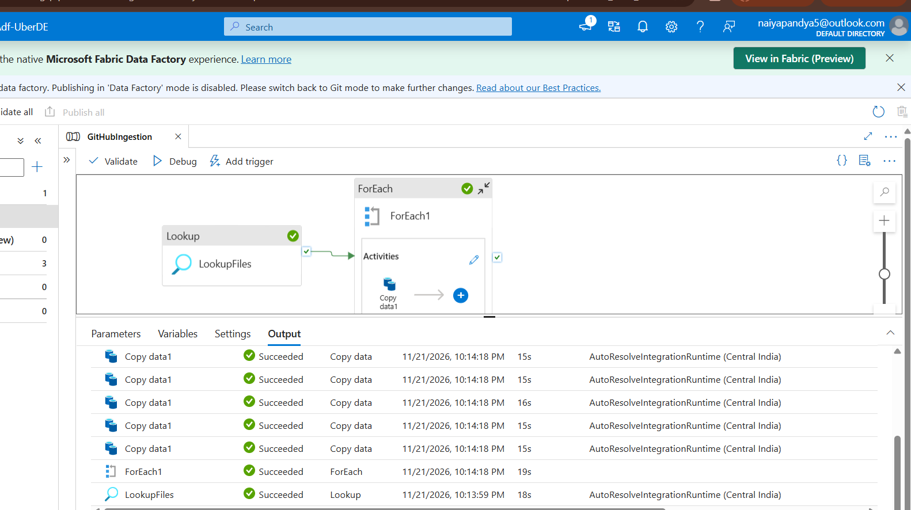
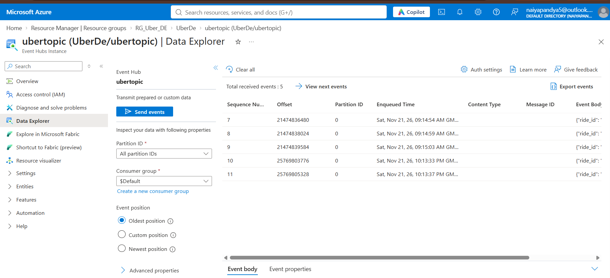
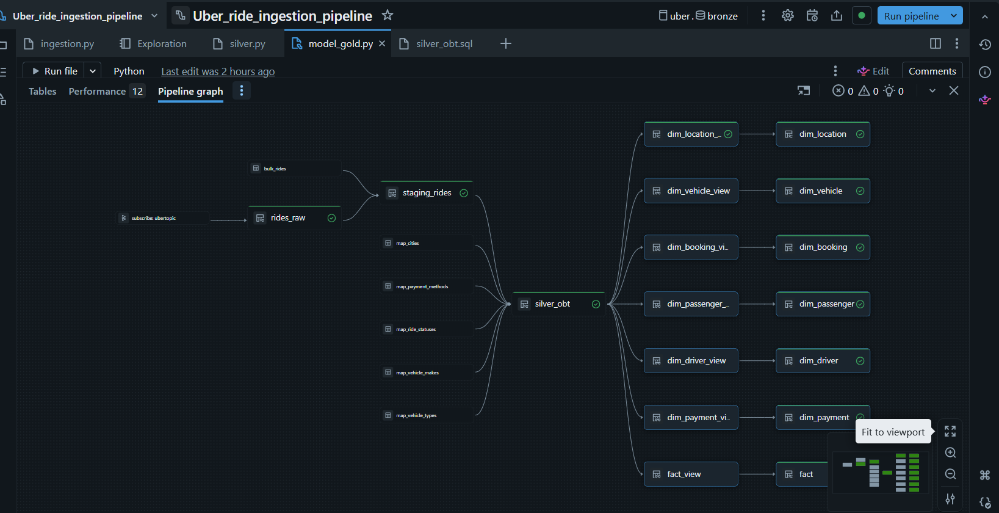
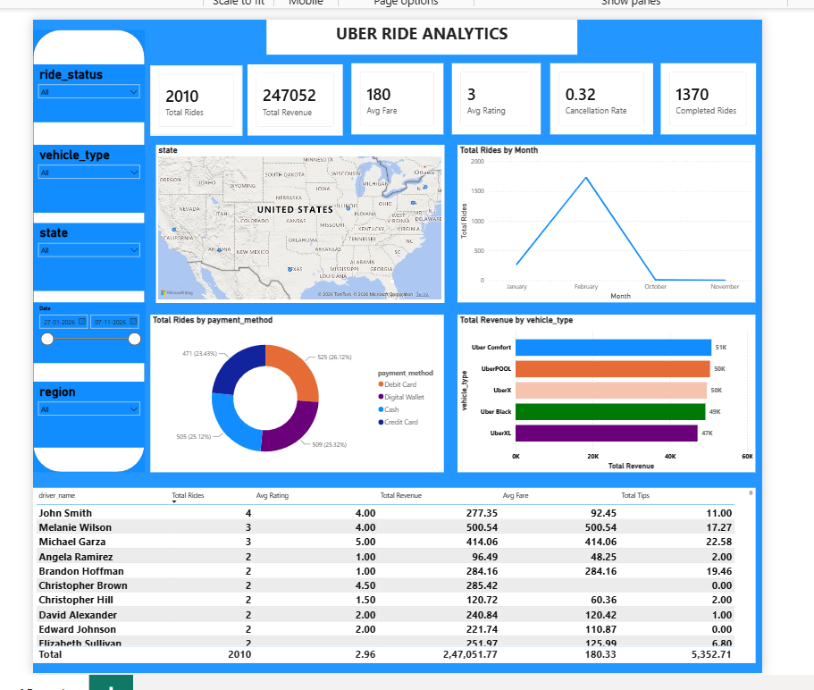

# UBER REAL-TIME DATA ENGINEERING PROJECT

##  Project Workflow

This project implements an end-to-end data engineering pipeline to process Uber ride-booking data using both real-time streaming and batch ingestion.

The workflow consists of the following stages:

1. **Real-Time Data Ingestion:** A web application generates ride-booking events whenever a user books a ride. Azure Event Hubs captures these events, which are consumed by Databricks for streaming processing.

2. **Batch Data Ingestion:** Azure Data Factory (ADF) retrieves initial load and mapping files from GitHub and stores them in Azure Data Lake Storage Gen2 (ADLS Gen2).

3. **Bronze Layer:** Stores raw data received through both streaming and batch ingestion.

4. **Silver Layer:** Uses PySpark and Spark Declarative Pipelines (SDP) to process initial and incremental data, perform streaming joins with mapping tables, and create an OBT (One Big Table). Jinja templates are used for dynamic SQL generation.

5. **Gold Layer:** Transforms enriched Silver data into Fact and Dimension tables using Star Schema modelling.

6. **Power BI:** Connects to the Gold Layer to create interactive dashboards and visualize Uber ride-booking insights.

## Azure Resource Group

All Azure resources used in this project.

## GitHub Ingestion: Mapping and Initial Files

## Ingestion Output

## Uber Ride Booking Data

## Databricks 

## Output (total rides)

## Power BI Dashboard

