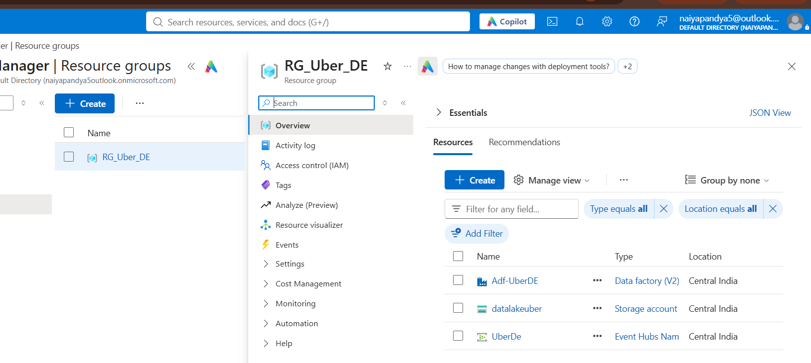
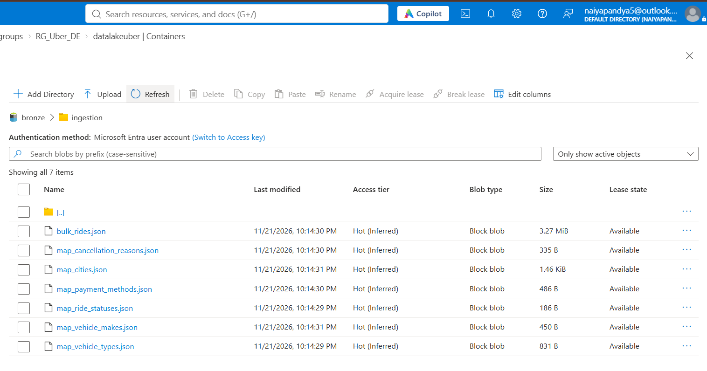
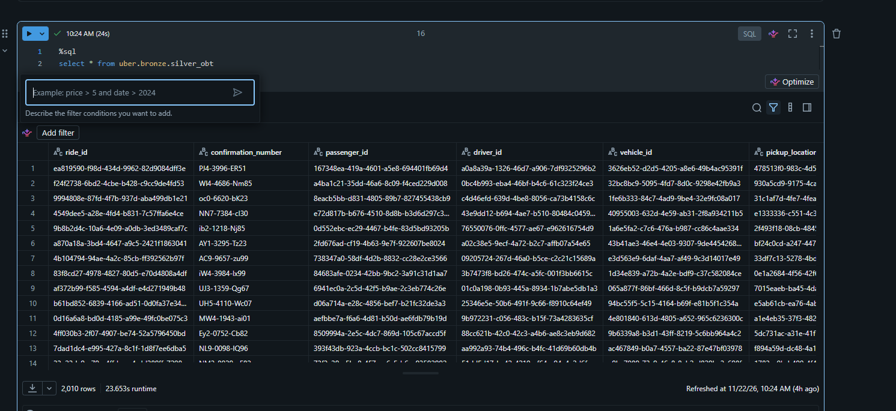
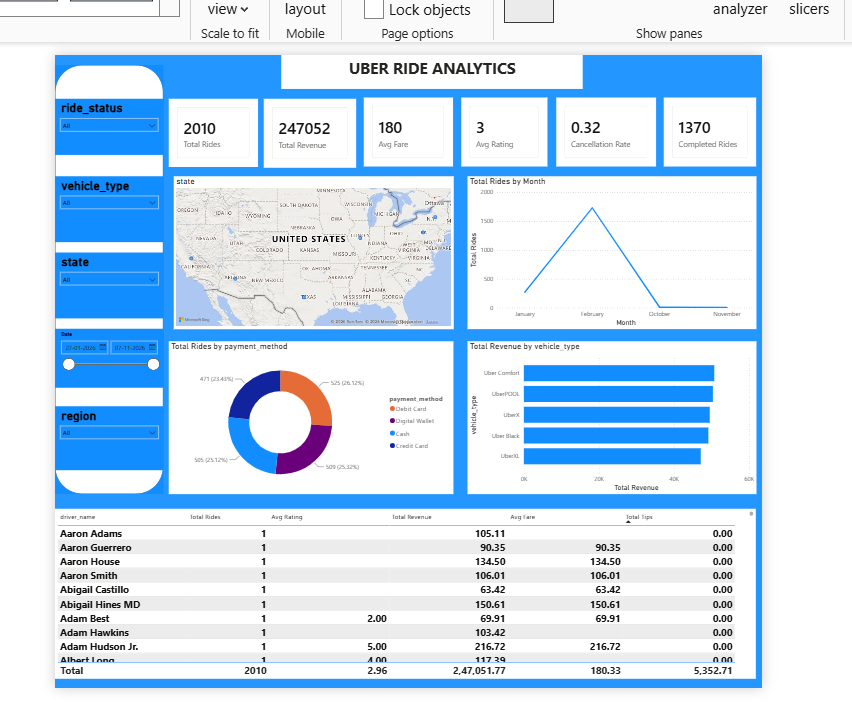

# UBER REAL-TIME DATA ENGINEERING PROJECT

## Azure Resource Group

All Azure resources used in this project.

## GitHub Ingestion: Mapping and Initial Files

## Ingestion Output

## Uber Ride Booking Data

## Databricks 

## Output (total rides)

## Power BI Dashboard

